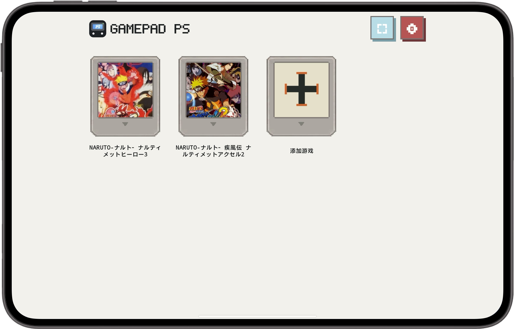

# GamePad PS

> **在 Android 平板上畅玩自己的 PS2 游戏库。**  
> Play your PS2 library on an Android tablet.

GamePad PS 游戏库截图 · GamePad PS library screenshot

<a href="https://gamefold.pages.dev">产品官网 / Official site</a> · <a href="https://github.com/lavande16/gamepad-ps/releases/tag/gamepad-ps-v0.4.1-8-baseline">下载 V0.4.1 / Download</a>

## 当前基线 · Current baseline

| 项目 | 信息 |
|---|---|
| 基线版本 | **GamePad PS V0.4.1 · versionCode 8** |
| Android 包名 | **com.gamepad.pspad** |
| 方向与显示 | 横屏游玩；默认 4× 渲染、LGFS 2×、Stretch 全屏、OSD 关闭 |
| 存储目录 | **GamePadPS** |
| 下载 | [GitHub Release：V0.4.1 / 8](https://github.com/lavande16/gamepad-ps/releases/tag/gamepad-ps-v0.4.1-8-baseline) |

## 为玩家准备的体验 · Made for players

- **整洁的游戏入口：**以卡带式游戏库进入 PS2 游戏，并支持自动装配与自动存档读档流程。  
  **A focused library:** launch from a cartridge-inspired collection with automatic game setup and save/load flow.
- **横屏平板游戏体验：**游戏内容与控制布局围绕 Android 平板的横屏显示安排，让大屏空间与操作区域更好配合。  
  **Landscape tablet play:** controls and content are arranged for landscape use on an Android tablet, making room for a comfortable big-screen session.
- **首次设置简单，之后由你掌控：**提供统一的图像与显示默认值；初始化后保留玩家后续的设置和进度。  
  **Simple defaults, your preferences:** graphics and display defaults are applied during setup, while later changes and progress are preserved.
- **兼容多种游戏目录：**支持 `game/game.iso`、`game/游戏名/game.iso` 和旧版 `game/游戏名/ISO/game.iso` 结构。  
  **Flexible game folders:** supported layouts include `game/game.iso`, `game/Title/game.iso` and the legacy `game/Title/ISO/game.iso` structure.

> 本项目不附带游戏 ROM、BIOS 或商业游戏素材。请只导入你有权使用的文件。GamePad PS 为独立爱好项目，与 PlayStation、Sony 或其他权利人没有隶属或授权关系。  
> Game files, BIOS files and commercial game assets are not included. Import only files you are entitled to use. This independent project is not affiliated with PlayStation, Sony or other rights holders.

## 从基线继续开发 · Continue from the baseline

本仓库保留 V0.4.1 源码基线、运行时、默认配置与构建工具。建议从 [实现计划](IMPLEMENTATION_PLAN.md)、[源码边界](SOURCE_LOCK.md)、[素材导入规则](MATERIALS.md)、[复用盘点](REUSE_INVENTORY.md) 和 [后续迁移说明](NEXT_PACKAGE_MIGRATION.md) 开始。APK 与版本号以 [V0.4.1 Release](https://github.com/lavande16/gamepad-ps/releases/tag/gamepad-ps-v0.4.1-8-baseline) 为准。

This repository preserves the V0.4.1 source baseline, runtime, defaults and build tools. Start with the [implementation plan](IMPLEMENTATION_PLAN.md), [source boundaries](SOURCE_LOCK.md), [materials guide](MATERIALS.md), [reuse inventory](REUSE_INVENTORY.md) and [migration notes](NEXT_PACKAGE_MIGRATION.md). The [V0.4.1 Release](https://github.com/lavande16/gamepad-ps/releases/tag/gamepad-ps-v0.4.1-8-baseline) is the version source of truth.

## GameFold / GamePad 产品矩阵 · Product family

GameFold 面向折叠屏手机，GamePad 面向 Android 平板。  
GameFold is for foldable phones; GamePad is for Android tablets.

| 产品线 / Product | 仓库 / Repository | 官网 / Website | 描述 / Description |
|---|---|---|---|
| GameFold NS | [gamefold-ns](https://github.com/lavande16/gamefold-ns) | [GameFold](https://gamefold.pages.dev) | 在折叠屏手机上运行 Switch 游戏。 Run Switch games on a foldable phone. |
| GameFold PC | [gamefold-pc](https://github.com/lavande16/gamefold-pc) | [GameFold](https://gamefold.pages.dev) | 在折叠屏手机上运行 PC 游戏。 Run PC games on a foldable phone. |
| GameFold FC | [gamefold-fc](https://github.com/lavande16/gamefold-fc) | [GameFold FC](https://game-fold.pages.dev) | 在折叠屏手机上运行 FC 游戏。 Run FC games on a foldable phone. |
| GamePad NS | [gamepad-ns](https://github.com/lavande16/gamepad-ns) | [GameFold](https://gamefold.pages.dev) | 在 Android 平板上运行 Switch 游戏。 Run Switch games on an Android tablet. |
| GamePad PC | [gamepad-pc](https://github.com/lavande16/gamepad-pc) | [GameFold](https://gamefold.pages.dev) | 在 Android 平板上整理并启动本地 PC 游戏。 Organize and launch local PC games on an Android tablet. |
| GamePad PS | [gamepad-ps](https://github.com/lavande16/gamepad-ps) | [GameFold](https://gamefold.pages.dev) | 在 Android 平板上畅玩自己的 PS2 游戏库。 Play your PS2 library on an Android tablet. |
